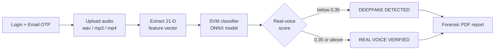

<div align="center">


*Upload a suspicious call recording and get an explainable verdict: **real voice** or **AI-generated deepfake**.*

<br/>


</div>

---

## 📌 Overview

**Vishing** (voice phishing) is on the rise, and scammers now use AI voice cloning to impersonate relatives, bank staff and officials. **Chronos-Voice** is a Streamlit app that analyses an audio recording, looks for acoustic signs of synthetic speech, and produces a downloadable audit report.

The detector extracts a **21-dimensional acoustic feature vector** from the audio and classifies it with an **SVM** that has been exported to **ONNX** for fast inference.

> **Disclaimer:** results are probabilistic and come from a model trained on a limited dataset. A "deepfake detected" or "real voice verified" result is a decision aid, not legal proof. Always confirm suspected fraud with your bank and the authorities.

---

## ✨ Features

| Feature | Description |
|---|---|
| 🎙️ **Audio upload** | Drag and drop `.wav`, `.mp3` or `.mp4` evidence |
| 🧠 **Deepfake detection** | 21-D acoustic features classified by an SVM (ONNX) |
| 📊 **Forensic metrics** | MFCC stability, pitch variance (F0) and a natural-breath indicator based on jitter |
| 🔐 **Email OTP login** | Six-digit one-time passcode sent through Gmail SMTP |
| 🧾 **PDF audit report** | Downloadable report with a SHA-256 based audit trace ID, timestamp and verdict |
| 🌐 **Multi-language UI** | English, Tamil and Hindi interface |
| 🛡️ **Cyber safety tips** | In-app safety guidance with a link to [cybercrime.gov.in](https://cybercrime.gov.in) |

---

## 🔍 How It Works



1. **Authenticate:** the user enters details and verifies a one-time passcode sent by email.
2. **Upload:** a recording is saved temporarily, analysed, then deleted.
3. **Extract features:** a 21-dimensional vector plus display metrics (MFCC stability, pitch, jitter) are computed.
4. **Classify:** the SVM returns a probability that the voice is real. A score **below 0.35** is flagged as a deepfake.
5. **Report:** the verdict, confidence, audit ID and timestamp are shown and can be exported as a PDF.

The **audit ID** is the first 16 characters of the SHA-256 hash of the uploaded file, so the same file always gets the same ID.

---

## 🛠️ Tech Stack

| Area | Technology |
|---|---|
| **App / UI** | Streamlit |
| **Audio and features** | Librosa, NumPy, MoviePy (video audio extraction) |
| **ML model** | scikit-learn `SVC` (RBF kernel, `C=10`, probability enabled) |
| **Inference** | ONNX Runtime, exported with `skl2onnx` |
| **Reports** | FPDF |
| **Email OTP** | Python `smtplib` (Gmail SSL) |

---

## 📁 Project Structure

```text
Chronos-Voice/
├── app.py              # Streamlit app: login, OTP, audit dashboard, report
├── train.py            # Trains the SVM and exports models/svm.onnx
├── src/
│   ├── features.py     # extract_21d_features(): 21-D vector + forensic metrics
│   └── classifier.py   # ChronosClassifier: loads the ONNX model and predicts
├── models/             # Exported model (svm.onnx)
├── requirements.txt
└── .gitignore
```

---

## 🚀 Getting Started

### 1. Install

```bash
git clone https://github.com/manjushriofc/Chronos-Voice.git
cd Chronos-Voice

python -m venv .venv
# Windows:      .venv\Scripts\activate
# macOS/Linux:  source .venv/bin/activate

pip install -r requirements.txt
```

> `ffmpeg` may be required for `.mp3` / `.mp4` decoding on some systems.

### 2. Configure email (for OTP)

The app reads Gmail credentials from **Streamlit secrets**. Create `.streamlit/secrets.toml`:

```toml
EMAIL_USER = "your_address@gmail.com"
EMAIL_PASS = "your_gmail_app_password"
```

Use a Gmail **App Password** (requires 2-step verification), not your normal password. On Streamlit Community Cloud, add the same two keys under **Advanced settings → Secrets**. Never commit this file.

### 3. Run

```bash
streamlit run app.py
```

Open the URL shown in your terminal (usually <http://localhost:8501>).

---

## 🧪 Training Your Own Model

`train.py` builds the classifier from a folder of labelled audio:

```text
data/
├── ai_voice/      # synthetic / cloned voices   -> label 0
└── real_voice/    # genuine human recordings    -> label 1
```

It scans the subfolders for `.wav`, `.mp3` and `.mp4` files, extracts the 21-D features, trains an SVM on an 80/20 split, prints the held-out accuracy and writes `models/svm.onnx`.

```bash
python train.py
```

> **Note:** `train.py` currently uses the hard-coded Windows path `C:\ChronosVoice` for `data/` and `models/`. Change `BASE_DIR` at the top of the file to match your setup (for example `os.path.dirname(__file__)`).

The training dataset is not included in this repository.

---

## 🔒 Privacy and Security Notes

- The login form asks for **name, email, phone and Aadhaar number**, and the Aadhaar number is printed in the PDF report. Aadhaar is sensitive personal data. Collect it only if you truly need it, mask it (for example show only the last 4 digits), and follow applicable Indian data-protection rules.
- Uploaded audio is written to a temporary file and removed after analysis. The data is held in the Streamlit session and is not saved to a database.
- OTPs are generated with Python's `random` module and have no expiry or attempt limit. For a production deployment, use the `secrets` module, add an expiry time and limit retries.
- Keep `EMAIL_USER` and `EMAIL_PASS` in secrets only, never in the source code.

---

## ⚠️ Known Limitations

- Accuracy depends entirely on the training data, which is not published here. Test the model on your own audio before trusting it.
- The **Language Model Focus** dropdown in the sidebar (Tamil, Hindi, Telugu, Malayalam) is informational at the moment and does not change the model.
- Compressed or noisy phone-call audio may reduce reliability.
- New voice-cloning systems appear often, so a model trained on older samples can miss newer fakes.

---

## 🗺️ Roadmap

- [ ] Publish evaluation results (accuracy, precision, recall, confusion matrix) on a held-out test set
- [ ] Language-specific models for the phonetic focus options
- [ ] Mask Aadhaar and other personal data in the UI and PDF
- [ ] Secure OTP generation with expiry and rate limiting
- [ ] Real-time call monitoring
- [ ] Dockerfile and one-click deployment

---

## 🛡️ Stay Safe from Vishing

- Never share OTPs, PINs or card details over a call, whoever the caller claims to be.
- If a voice asks for urgent money, hang up and call the person back on a number you already know.
- In India, report cyber fraud at **[cybercrime.gov.in](https://cybercrime.gov.in)** or call the national cyber crime helpline **1930**.

---

<div align="center">


</div>
